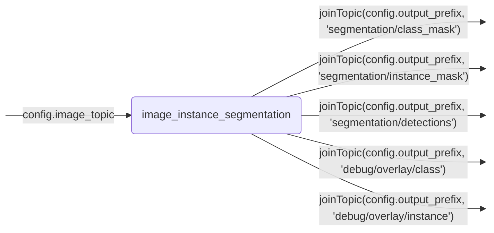

# `image_instance_segmentation`

Image instance segmentation inference node backed by Triton

Configure the node with the [parameter file](config/params.yml).

## Nodes

### `image_instance_segmentation`

**Cameras and outputs**

List camera names in `cameras` and configure each under `camera.<name>`:

| Parameter | Meaning |
| --- | --- |
| `camera.<name>.image_topic` | Base image topic |
| `camera.<name>.transport` | `raw` or `compressed`; omit `/compressed` from the base topic |
| `camera.<name>.output_prefix` | Prefix for segmentation and overlay outputs |

The supplied parameter file configures one camera with raw transport, enables
tracking, and selects RF-DETR-Seg decoding.

For the default camera, launch arguments remap the input and all output topics:

```bash
ros2 launch image_instance_segmentation image_instance_segmentation.launch.py \
  image_topic:=/camera/image_rect detections_topic:=/perception/detections
```

For multiple cameras, set `cameras: [left, right]` and configure each
`camera.<name>` entry. Their default inputs are `~/<name>/image` and outputs
are under `~/<name>/segmentation/`.

Outputs preserve the input image dimensions, timestamp, and frame ID.
Subscriptions use sensor-data QoS. Class masks contain `model.class_ids`;
zero is background. Instance masks contain per-frame IDs or per-camera track IDs.
`Detection2D.id` contains the track ID when tracking is enabled. Track IDs can be
reused after a track ends.

In the topic tables, `config.image_topic` is the configured input and `joinTopic`
places outputs under the camera's prefix. Parameter names `image_topic`,
`transport`, and `output_prefix` are per-camera suffixes.

**Triton model**

Set `prediction.triton_server_url`, `prediction.model_name`, and
`prediction.model_version` for your model, and select its output decoding with
`model.architecture`. Tensor names (under `model.yolo` or `model.rfdetr`) and
FP32/FP16 precision are configurable. The input is always `[1, 3, H, W]` RGB
normalized to `[0, 1]`.

| `model.architecture` | Resize | Outputs |
| --- | --- | --- |
| `yolo` (YOLOv8/v11) | Letterbox | Detections `cx, cy, w, h, class scores..., mask coefficients...` and mask prototypes |
| `yolo26` | Letterbox | Detections `x1, y1, x2, y2, confidence, class_id, mask coefficients...` and mask prototypes |
| `rfdetr` (RF-DETR-Seg) | Stretch | Boxes `[1, queries, 4]` (normalized `cx, cy, w, h`), class logits `[1, queries, classes(+1)]`, mask logits `[1, queries, h, w]` |

YOLO detections are `[1, channels, anchors]` or `[1, anchors, channels]` and
prototypes `[1, mask_channels, mask_height, mask_width]`. RF-DETR yields one
detection per query and class above the confidence threshold. For models that
perform additional resizing and normalization inside the graph, set the node
input size to the model's exported input resolution.

Output dimensions must stay fixed for the configured input size. The node
resolves dynamic tensor metadata with an inference request during startup.
`model.class_names` follows model-output class order; `model.class_ids` contains
the corresponding semantic mask IDs in `1..65535`.

The `triton_server_url` launch argument sets the endpoint, defaults to
`triton-server:8001`, and takes precedence over the YAML value.
Shared memory (`prediction.use_shm`) requires a shared POSIX IPC namespace and
Triton client shared-memory access.

**Tracking and throughput**

Tracking uses a separate ByteTrack tracker per camera, configured under
`tracking`. YOLOv8/v11 and RF-DETR detections use per-class NMS; YOLO26 uses
model selection.
Cameras run concurrently with one Triton client each. Busy cameras drop frames
at the admission limit. Set `prediction.max_in_flight_per_camera: 1` for low
latency; tracking enforces this limit to preserve frame order.

Enable `debug.publish_overlay` for overlays and `debug.print_timing` for
processing times.
Use `ros_tracing:=true` to enable OpenADS dual-session tracing. Service images
include the `jazzy-ika` tracing fork.

Postprocessing thresholds and `debug.*` settings support runtime changes through
`ros2 param set`. Model, camera, and tracker settings are read-only after startup.
Numeric parameters expose valid ranges through `ros2 param describe`.



#### Subscribed Topics

| Topic | Type | Description |
| --- | --- | --- |
| `config.image_topic` | `sensor_msgs/msg/Image` | Camera image received through the configured raw or compressed transport |

#### Published Topics

| Topic | Type | Description |
| --- | --- | --- |
| `joinTopic(config.output_prefix, "segmentation/class_mask")` | `sensor_msgs/msg/Image` | `mono16` semantic class IDs; zero is background |
| `joinTopic(config.output_prefix, "segmentation/instance_mask")` | `sensor_msgs/msg/Image` | `mono16` instance IDs; track IDs when tracking is enabled; zero is background |
| `joinTopic(config.output_prefix, "segmentation/detections")` | `vision_msgs/msg/Detection2DArray` | Pixel-coordinate boxes, class names, confidence scores, and optional track IDs |
| `joinTopic(config.output_prefix, "debug/overlay/class")` | `sensor_msgs/msg/Image` | Optional `bgr8` overlay colored by class |
| `joinTopic(config.output_prefix, "debug/overlay/instance")` | `sensor_msgs/msg/Image` | Optional `bgr8` overlay colored by instance or track |

#### Parameters

| Parameter | Type | Default | Description |
| --- | --- | --- | --- |
| `prediction.triton_server_url` | `string` | `"triton-server:8001"` | Triton gRPC host and port |
| `prediction.model_name` | `string` | `"rfdetr-seg-small"` | Triton model name |
| `prediction.model_version` | `string` | `"1"` | Triton model version |
| `prediction.triton_client_timeout_s` | `float` | `2.0` | Triton request timeout in seconds |
| `prediction.use_shm` | `bool` | `false` | Use Triton shared memory transport |
| `prediction.max_in_flight_per_camera` | `int` | `1` | Maximum admitted frames per camera; tracking forces one |
| `model.architecture` | `string` | `"rfdetr"` | Output decoding: yolo (YOLOv8/v11), yolo26, or rfdetr |
| `model.input_width` | `int` | `1280` | Model input width in pixels |
| `model.input_height` | `int` | `720` | Model input height in pixels |
| `model.input_tensor_name` | `string` | `"input"` | Input tensor name |
| `model.rfdetr.boxes_output_tensor_name` | `string` | `"dets"` | RF-DETR box tensor name |
| `model.rfdetr.logits_output_tensor_name` | `string` | `"labels"` | RF-DETR class logit tensor name |
| `model.rfdetr.masks_output_tensor_name` | `string` | `"masks"` | RF-DETR mask tensor name |
| `model.yolo.detections_output_tensor_name` | `string` | `"output0"` | YOLO detection tensor name |
| `model.yolo.prototypes_output_tensor_name` | `string` | `"output1"` | YOLO mask prototype tensor name |
| `model.input_tensor_data_type` | `string` | `"fp16"` | Triton input tensor dtype: fp32 or fp16 |
| `model.output_tensor_data_type` | `string` | `"fp16"` | Triton output tensor dtype: fp32 or fp16 |
| `model.class_names` | `string[]` | `["PEDESTRIAN", "BICYCLE", "MOTORCYCLE", "CAR", "UTILITY", "BUS", "ANIMAL", "VRU", "MICRO", "TRAFFIC_LIGHT", "TRAFFIC_SIGN"]` | Class names in contiguous model-output order |
| `model.class_ids` | `int[]` | `[1, 2, 3, 4, 5, 7, 8, 12, 13, 20, 29]` | Semantic IDs written into `class_mask`; zero is reserved for background |
| `postprocessing.confidence_threshold` | `float` | `0.25` | Minimum detection confidence; tracking also uses its low-confidence threshold |
| `postprocessing.mask_threshold` | `float` | `0.5` | Binary mask threshold |
| `postprocessing.nms_iou_threshold` | `float` | `0.45` | Per-class NMS IoU threshold; YOLO26 selects detections in the model |
| `tracking.enabled` | `bool` | `true` | Enable per-camera ByteTrack-based tracking |
| `tracking.backend` | `string` | `"bytetrack"` | Tracking backend; only `bytetrack` is supported |
| `tracking.high_confidence_threshold` | `float` | `0.5` | High-confidence association threshold |
| `tracking.low_confidence_threshold` | `float` | `0.1` | Low-confidence association threshold |
| `tracking.new_track_confidence_threshold` | `float` | `0.6` | Minimum score required to start a new track |
| `tracking.match_iou_threshold` | `float` | `0.3` | Minimum IoU used for tracker association |
| `tracking.max_lost_frames` | `int` | `30` | Frames a track may remain unmatched before retirement |
| `tracking.min_box_area_px` | `float` | `25.0` | Minimum detection area eligible for tracking |
| `debug.publish_overlay` | `bool` | `false` | Publish overlay images |
| `debug.print_timing` | `bool` | `false` | Log inference, postprocessing, and total processing times |
| `debug.overlay_alpha` | `float` | `0.45` | Mask opacity in debug overlays |
| `debug.overlay_draw_boxes` | `bool` | `true` | Draw boxes and labels in debug overlays |
| `cameras` | `string[]` | `["camera"]` | Names of cameras to process |
| `image_topic` | `string` | `"~/image"` | Raw image base topic |
| `transport` | `string` | `"raw"` | Image transport hint: raw or compressed |
| `output_prefix` | `string` | `"~"` | Prefix for this camera's output topics |

## Launch Files

### [`image_instance_segmentation.launch.py`](launch/image_instance_segmentation.launch.py)

| Argument | Default | Description |
| --- | --- | --- |
| `image_topic` | `"~/image"` | input image topic remap |
| `class_mask_topic` | `"~/segmentation/class_mask"` | semantic mask topic remap |
| `instance_mask_topic` | `"~/segmentation/instance_mask"` | instance mask topic remap |
| `detections_topic` | `"~/segmentation/detections"` | 2D detections topic remap |
| `class_overlay_topic` | `"~/debug/overlay/class"` | class overlay topic remap |
| `instance_overlay_topic` | `"~/debug/overlay/instance"` | instance overlay topic remap |
| `name` | `"image_instance_segmentation"` | node name |
| `namespace` | `""` | node namespace |
| `params` | `os.path.join(
                get_package_share_directory("image_instance_segmentation"), "config", "params.yml"
            )` | path to parameter file |
| `log_level` | `"info"` | ROS logging level (debug, info, warn, error, fatal) |
| `use_sim_time` | `"false"` | use simulation clock |
| `ros_tracing` | `"false"` | Enable tracing |
| `triton_server_url` | `"triton-server:8001"` | Triton server URL |
