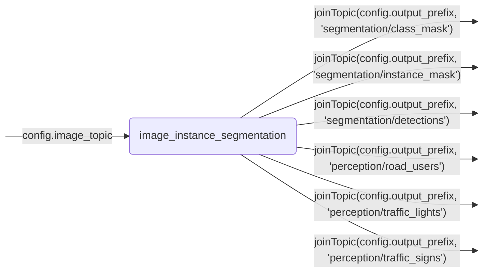

# `image_instance_segmentation`

Image instance segmentation inference node backed by Triton

## Nodes

### `image_instance_segmentation`

Image instance segmentation inference node backed by Triton

See [configuration and diagnostics](../docs/IMPLEMENTATION.md).

#### Subscribed Topics

| Topic | Type | Description |
| --- | --- | --- |
| `config.image_topic` | `sensor_msgs/msg/Image` | Camera image received through the configured raw or compressed transport |

#### Published Topics

| Topic | Type | Description |
| --- | --- | --- |
| `joinTopic(config.output_prefix, "segmentation/class_mask")` | `sensor_msgs/msg/Image` | `mono16` semantic class IDs; zero is background |
| `joinTopic(config.output_prefix, "segmentation/instance_mask")` | `sensor_msgs/msg/Image` | `mono16` instance IDs; track IDs when tracking is enabled; zero is background |
| `joinTopic(config.output_prefix, "segmentation/detections")` | `vision_msgs/msg/Detection2DArray` | Pixel-coordinate boxes, class names, confidence scores, and optional track IDs |
| `joinTopic(config.output_prefix, "perception/road_users")` | `perception_msgs/msg/ObjectList` | Optional image-only road users (`HEXAMOTION`) with source camera observations |
| `joinTopic(config.output_prefix, "perception/traffic_lights")` | `perception_msgs/msg/ObjectList` | Optional image-only traffic lights (`TRAFFICLIGHT`) with source camera observations |
| `joinTopic(config.output_prefix, "perception/traffic_signs")` | `perception_msgs/msg/ObjectList` | Optional image-only traffic signs (`TRAFFICSIGN`) with source camera observations |

#### Parameters

| Parameter | Type | Default | Description |
| --- | --- | --- | --- |
| `prediction.triton_server_url` | `string` | `"triton-server:8001"` | Triton gRPC host and port |
| `prediction.model_name` | `string` | `"rfdetr-seg-small"` | Triton model name |
| `prediction.model_version` | `string` | `"1"` | Triton model version |
| `prediction.triton_client_timeout_s` | `float` | `2.0` | Triton request timeout in seconds |
| `prediction.use_shm` | `bool` | `false` | Use Triton shared memory transport |
| `prediction.max_in_flight_per_camera` | `int` | `1` | Maximum admitted frames per camera; tracking forces one |
| `model.architecture` | `string` | `"rfdetr"` | Output decoding: yolo (YOLOv8/v11), yolo26, or rfdetr |
| `model.input_width` | `int` | `1280` | Model input width in pixels |
| `model.input_height` | `int` | `720` | Model input height in pixels |
| `model.input_tensor_name` | `string` | `"input"` | Input tensor name |
| `model.rfdetr.boxes_output_tensor_name` | `string` | `"dets"` | RF-DETR box tensor name |
| `model.rfdetr.logits_output_tensor_name` | `string` | `"labels"` | RF-DETR class logit tensor name |
| `model.rfdetr.masks_output_tensor_name` | `string` | `"masks"` | RF-DETR mask tensor name |
| `model.yolo.detections_output_tensor_name` | `string` | `"output0"` | YOLO detection tensor name |
| `model.yolo.prototypes_output_tensor_name` | `string` | `"output1"` | YOLO mask prototype tensor name |
| `model.input_tensor_data_type` | `string` | `"fp16"` | Triton input tensor dtype: fp32 or fp16 |
| `model.output_tensor_data_type` | `string` | `"fp16"` | Triton output tensor dtype: fp32 or fp16 |
| `model.class_names` | `string[]` | `["PEDESTRIAN", "BICYCLE", "MOTORCYCLE", "CAR", "UTILITY", "BUS", "ANIMAL", "VRU", "MICRO", "TRAFFIC_LIGHT", "TRAFFIC_SIGN"]` | Class names in contiguous model-output order |
| `model.class_ids` | `int[]` | `[1, 2, 3, 4, 5, 7, 8, 12, 13, 20, 29]` | Semantic IDs written into `class_mask`; zero is reserved for background |
| `postprocessing.confidence_threshold` | `float` | `0.25` | Minimum detection confidence; tracking also uses its low-confidence threshold |
| `postprocessing.mask_threshold` | `float` | `0.5` | Binary mask threshold |
| `postprocessing.nms_iou_threshold` | `float` | `0.45` | Per-class NMS IoU threshold; YOLO26 selects detections in the model |
| `tracking.enabled` | `bool` | `true` | Enable per-camera ByteTrack-based tracking |
| `tracking.backend` | `string` | `"bytetrack"` | Tracking backend; only `bytetrack` is supported |
| `tracking.high_confidence_threshold` | `float` | `0.5` | High-confidence association threshold |
| `tracking.low_confidence_threshold` | `float` | `0.1` | Low-confidence association threshold |
| `tracking.new_track_confidence_threshold` | `float` | `0.6` | Minimum score required to start a new track |
| `tracking.match_iou_threshold` | `float` | `0.3` | Minimum IoU used for tracker association |
| `tracking.max_lost_frames` | `int` | `30` | Frames a track may remain unmatched before retirement |
| `tracking.min_box_area_px` | `float` | `25.0` | Minimum detection area eligible for tracking |
| `perception.publish_road_users` | `bool` | `false` | Publish image-only road-user object lists |
| `perception.publish_traffic_lights` | `bool` | `false` | Publish image-only traffic-light object lists |
| `perception.publish_traffic_signs` | `bool` | `false` | Publish image-only traffic-sign object lists |
| `perception.include_crops` | `bool` | `true` | Include BGR image crops in perception objects |
| `perception.include_masks` | `bool` | `true` | Include binary instance masks in perception objects |
| `debug.print_timing` | `bool` | `false` | Log inference, postprocessing, and total processing times |
| `cameras` | `string[]` | `["camera"]` | Names of cameras to process |
| `sensor_id` | `int` | `1` | Non-negative camera identifier in perception observations |
| `image_topic` | `string` | `"~/image"` | Raw image base topic |
| `transport` | `string` | `"raw"` | Image transport hint: raw or compressed |
| `output_prefix` | `string` | `"~"` | Prefix for this camera's output topics |

## Launch Files

### [`image_instance_segmentation.launch.py`](launch/image_instance_segmentation.launch.py)

| Argument | Default | Description |
| --- | --- | --- |
| `diagnostics_topic` | `"/diagnostics"` | diagnostics topic remap |
| `image_topic` | `"~/image"` | input image topic remap |
| `class_mask_topic` | `"~/segmentation/class_mask"` | semantic mask topic remap |
| `instance_mask_topic` | `"~/segmentation/instance_mask"` | instance mask topic remap |
| `detections_topic` | `"~/segmentation/detections"` | 2D detections topic remap |
| `road_users_topic` | `"~/perception/road_users"` | road-user objects topic remap |
| `traffic_lights_topic` | `"~/perception/traffic_lights"` | traffic-light objects topic remap |
| `traffic_signs_topic` | `"~/perception/traffic_signs"` | traffic-sign objects topic remap |
| `name` | `"image_instance_segmentation"` | node name |
| `namespace` | `""` | node namespace |
| `params` | `os.path.join(
                get_package_share_directory("image_instance_segmentation"), "config", "params.yml"
            )` | path to parameter file |
| `log_level` | `"info"` | ROS logging level (debug, info, warn, error, fatal) |
| `use_sim_time` | `"false"` | use simulation clock |
| `ros_tracing` | `"false"` | Enable tracing |
| `triton_server_url` | `"triton-server:8001"` | Triton server URL |
